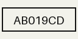

# PP-OCRv6 recognition experiments

[Download and prepare the public energy-meter example](notebooks/00_download_ocr_example.ipynb). Use the same saved crop and checkpoint to compare native and TensorRT inference.

<!-- ocr-family-comparison:start -->

## Choose an OCR model

### Price-tag OCR

This public dummy crop should produce `109.51`. The decimal point changes the value, so dropping it fails exact match. Real tags also print cents in smaller, raised type, move the currency symbol, and add nearby text. The model has to identify the requested price, put its parts in reading order, and ignore other numbers.

#### Price development

| Rank | Model family | Variant | Parameters | Input H×W | Exact match | RGB / encoded mean | GPU peak |
|---:|---|---|---:|---|---:|---:|---:|
| 1 | Florence-2 | Base, optimized TensorRT price | 231.41M | 384×384 | 106/144 (73.61%) | 5.37 / 5.62 ms | 1,454 MiB |
| 1 | [WATERec](https://github.com/algofly-oss/waterec-ocr-training) | R2048, price | 26.12M | 128×256 | 106/144 (73.61%) | 1.97 / 2.20 ms | 716 MiB |
| 3 | [Florence-2](https://github.com/algofly-oss/florence2-ocr-training) | Base, PyTorch price | 231.41M | 384×384 | 105/144 (72.92%) | 35.37 / 35.53 ms | 1,768 MiB |
| 4 | [PP-OCRv6](https://github.com/algofly-oss/ppocrv6-ocr-training) | Medium mixed, price | 15.58M | 128×320 | 104/144 (72.22%) | 0.88 / 1.09 ms | 654 MiB |
| 4 | PP-OCRv6 | Medium FP32, price | 15.58M | 128×320 | 104/144 (72.22%) | 1.41 / 1.69 ms | 588 MiB |
| 6 | CCT | CCT64, price | 0.98M | 64×128 | 66/144 (45.83%) | 0.75 / 0.94 ms | 542 MiB |
| 7 | CCT | CCT128, price | 1.15M | 128×256 | 65/144 (45.14%) | — | — |

#### Broader corrected price

| Rank | Model family | Variant | Parameters | Input H×W | Exact match | RGB / encoded mean | GPU peak |
|---:|---|---|---:|---|---:|---:|---:|
| 1 | [WATERec](https://github.com/algofly-oss/waterec-ocr-training) | R2048, price | 26.12M | 128×256 | 163/206 (79.13%) | 1.97 / 2.20 ms | 716 MiB |
| 1 | [PP-OCRv6](https://github.com/algofly-oss/ppocrv6-ocr-training) | Medium mixed, price | 15.58M | 128×320 | 163/206 (79.13%) | 0.88 / 1.09 ms | 654 MiB |
| 3 | [Florence-2](https://github.com/algofly-oss/florence2-ocr-training) | Base, PyTorch price | 231.41M | 384×384 | 159/206 (77.18%) | 35.37 / 35.53 ms | 1,768 MiB |
| 4 | Florence-2 | Base, optimized TensorRT price | 231.41M | 384×384 | 157/206 (76.21%) | 5.37 / 5.62 ms | 1,454 MiB |

#### Historical price

| Rank | Model family | Variant | Parameters | Input H×W | Exact match | RGB / encoded mean | GPU peak |
|---:|---|---|---:|---|---:|---:|---:|
| 1 | [PARSeq](https://github.com/algofly-oss/parseq-ocr-training) | Base, price | 23.98M | 64×256 | 148/206 (71.84%) | — | — |
| 2 | PARSeq | Tiny, native BF16 price | 6.09M | 64×256 | 118/206 (57.28%) | — | — |
| 3 | PARSeq | Fast Tiny, price | 6.05M | 48×192 | 112/206 (54.37%) | 0.89 / 1.09 ms | 688 MiB |

### License-plate recognition (LPR)

This public dummy crop should produce `AB019CD`. The model must read the characters inside the border in order and distinguish lookalikes such as `0` and `O`. In real crops, unfamiliar fonts, stacked rows, rotation, glare, and blur make those decisions harder. One wrong or missing character fails exact match.

#### LPR development

| Rank | Model family | Variant | Parameters | Input H×W | Exact match | RGB / encoded mean | GPU peak |
|---:|---|---|---:|---|---:|---:|---:|
| 1 | PP-OCRv6 | Medium height 128, plates | 15.58M | 128×320 bound | 1,027/1,167 (88.00%) | 0.96 / 1.09 ms | 654 MiB |
| 2 | PP-OCRv6 | Medium height 48, plates | 15.58M | Height 48 | 1,001/1,167 (85.78%) | 0.76 / 0.94 ms | 650 MiB |
| 3 | [CCT](https://github.com/algofly-oss/cct-ocr-training) | CCT-S, plates | 0.98M | 64×128 | 953/1,167 (81.66%) | 0.85 / 1.03 ms | 542 MiB |

#### LPR validation

| Rank | Model family | Variant | Parameters | Input H×W | Exact match | RGB / encoded mean | GPU peak |
|---:|---|---|---:|---|---:|---:|---:|
| 1 | WATERec | RS, plates | 26.12M | Aspect-preserving, ≤512 patches | 2,475/2,693 (91.90%) | 1.26 / 2.26 ms | 694 MiB |
| 2 | PARSeq | Fast Tiny, plates | 6.05M | 48×192 | 2,377/2,693 (88.27%) | 0.69 / 1.66 ms | 682 MiB |

#### Reviewed unseen plates

| Rank | Model family | Variant | Parameters | Input H×W | Exact match | RGB / encoded mean | GPU peak |
|---:|---|---|---:|---|---:|---:|---:|
| 1 | PARSeq | Fast Tiny, plates | 6.05M | 48×192 | 715/984 (72.66%) | 0.69 / 1.66 ms | 682 MiB |
| 2 | [CCT](https://github.com/algofly-oss/cct-ocr-training) | CCT-S, plates | 0.98M | 64×128 | 628/984 (63.82%) | 0.85 / 1.03 ms | 542 MiB |
| 3 | PP-OCRv6 | Medium height 48, plates | 15.58M | Height 48 | 626/984 (63.62%) | 0.76 / 0.94 ms | 650 MiB |
| 4 | PP-OCRv6 | Medium height 128, plates | 15.58M | 128×320 bound | 534/984 (54.27%) | 0.96 / 1.09 ms | 654 MiB |

- **Fast recognition on a tight latency budget:** start with PP-OCRv6. Its price-tag mixed-precision build matched the FP32 exact score, with numerical differences.
- **Unseen plate layouts:** start with WATERec. The separately adapted WATE plate checkpoint reached 855/984 on reviewed wild crops.
- **Smallest model:** CCT-S is about 1M parameters. Use it when the input resembles its training distribution.
- **Custom text selection and ordering:** benchmark Florence-2 on your own annotation policy. Its faster TensorRT path lost two exact matches versus PyTorch on the broader price-tag evaluation.

Timings are batch 1 on an RTX 5090, with preprocessing, recognition and text decoding included. Encoded scope includes image decoding and may include file reads in historical runs. GPU peak is driver-accounted memory. Exact match uses the literal full string. Compare accuracy within the same label version and split: historical PARSeq price scores use an earlier label policy, and the broader corrected price cohort includes 68 provisional labels. A dash means a comparable result is unavailable. The latest Florence values are research measurements; see its repository for the executable versions.

<!-- ocr-family-comparison:end -->

This repository documents PP-OCRv6 recognition experiments on cropped license plates and retail price tags. The model reads a supplied crop. Detection and crop generation are outside the benchmark.

| Task and checkpoint | Parameters | Input H×W | Development exact match | RGB latency | Encoded latency | Peak GPU memory |
|---|---:|---:|---:|---:|---:|---:|
| Price tags, mixed precision | 15.58M | 128×320 | 104/144 (72.22%) | 0.884 ms | 1.087 ms | 654 MiB |
| ALPR, height 128 | 15.58M | 128×320 | 1,027/1,167 (88.00%) | 0.964 ms | 1.094 ms | 654 MiB |

The RTX 5090 measurements use batch size one and include preprocessing, TensorRT inference, and text decoding. Encoded latency also includes decoding image bytes already in memory. Loading and warmup are excluded from latency. Peak memory is driver-accounted for the inference process.

Exact match compares the full string, including decimal punctuation and currency text. Mixed precision preserved the measured price-tag exact-match total, but failed a stricter numerical comparison. A separate FP32 TensorRT run scored 104/144 at 1.413 ms with 588 MiB peak GPU memory.

On 984 reviewed wild plate crops, optimized recognition matched 534 with the height-128 configuration and 626 with the height-48 configuration. The higher development score at height 128 did not carry over to that cohort. The price-tag mixed-precision model matched 163/206 on the broader historical set, which includes 68 provisional references.

Start with the [price training and TensorRT notebook](notebooks/1_train_export_infer.ipynb). It uses fictional crops to show the complete workflow. The ALPR rows describe the research checkpoints. Private datasets, trained checkpoints, and GPU engines are excluded.
