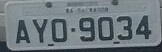

# PP-OCRv6 recognition experiments

[Download the public energy-meter example](notebooks/00_download_ocr_example.ipynb), then open [1_train_export_infer.ipynb](notebooks/1_train_export_infer.ipynb). Open the end-to-end notebook and set `USE_ENERGY_METER = True` in its configuration cell. Each run keeps its artifacts in a dataset-specific directory.

[Train, export and run in Jupyter](notebooks/1_train_export_infer.ipynb). The notebook exposes the training loop and copyable TensorRT runtime.

Install the notebook and training dependencies from the checkout:

```bash
python -m pip install -e '.[notebooks,ppocr]'
```

On an NVIDIA CUDA host, add `ppocr-tensorrt` and enable `RUN_TENSORRT` in the notebook. The runtime builds an engine from the exported ONNX bundle on the target GPU.

## Choose a recognition model

Set `MODEL_VARIANT` in the first configuration cell of the [training notebook](notebooks/1_train_export_infer.ipynb) to `"tiny"`, `"small"`, or `"medium"` (default). Each variant has its own pinned pretrained files, checkpoints and export directory. Training takes cropped images with text labels. Set `RUN_TENSORRT = True` to export and build the selected model. The corrected-price and precursor research recipes use Medium.

| Notebook setting | CLI training preset | Notebook input H×W |
|---|---|---|
| `tiny` | [Tiny](configs/ppocr_price_tiny.yaml) | 128×320 |
| `small` | [Small](configs/ppocr_price_small.yaml) | 128×320 |
| `medium` | [Medium](configs/ppocr_price.yaml) | 128×320 |

These are the three upstream PP-OCRv6 recognition sizes. The notebook adapts the recognition head to its task vocabulary. [PaddleX model list](https://paddlepaddle.github.io/PaddleX/latest/en/module_usage/tutorials/ocr_modules/text_recognition.html)

## Compare the tested TensorRT profiles

Input dimensions are **height × width in pixels**. In a video pipeline, pass the detected plate or price-tag crop to the recognizer. The camera frame, source crop, and resized OCR input can each have different dimensions. Fixed-size models use the dimensions shown in the table. WATERec preserves the crop aspect ratio approximately, aligns both sides to multiples of four, and uses 4×4-pixel patches.

All 206 corrected price crops were **160×320** at source and became **84×168** at the 896-patch setting. Reviewed plate crops varied in shape. At 512 patches, **68×116** was the most frequent OCR input (90/984 crops). One **72×210** source plate became **52×152**. These example dimensions describe inference on the benchmark crops.

### Price tags


Expected output is `107.25`. On real tags, cents can be raised or smaller, a currency symbol can split the amount, and unit prices can compete with the headline price. [Open a real benchmark price tag](https://prices.openfoodfacts.org/img/price-tags/000/123/000123564.webp)


| Model | Params | OCR input H×W (px) | Corrected tags | Public photos | Latency¹ | GPU¹ |
|---|---:|---|---:|---:|---:|---:|
| [WATERec](https://github.com/algofly-oss/waterec-ocr-training) rank-192 | 20.84M | dynamic, e.g. 84×168 (≤896 patches) | **163/206 (79.13%)** | **49/71 (69.01%)** | 1.17 ms | 724 MiB |
| [PP-OCRv6](https://github.com/algofly-oss/ppocrv6-ocr-training) Medium | 15.58M | 128×320 | **163/206 (79.13%)** | 6/71 (8.45%) | 0.77 ms | 656 MiB |
| [PP-OCRv6](https://github.com/algofly-oss/ppocrv6-ocr-training) Small | 3.04M | 128×320 | 160/206 (77.67%) | 13/71 (18.31%) | **0.60 ms** | 652 MiB |
| [Florence-2](https://github.com/algofly-oss/florence2-ocr-training) Base | 231.41M | 384×384 | 157/206 (76.21%) | 3/71 (4.23%) | 4.95 ms | 1,452 MiB |
| [PARSeq](https://github.com/algofly-oss/parseq-ocr-training) Fast Tiny | 6.05M | 48×192 | 44/206 (21.36%) | 2/71 (2.82%) | 0.89 ms | 688 MiB |

¹ Mean from decoded RGB on the corrected price crops, RTX 5090, batch one. GPU memory is the sampled process peak. Ranking prioritizes corrected exact matches, then public exact matches. The corrected set includes 68 provisional labels.

### License plates


Expected output is `AB100CD223`. On real crops the reader must keep the character order across unfamiliar fonts, stacked rows, glare, and blur.



The international evaluation uses this crop from the OpenALPR benchmark. The recognizer receives the cropped plate and the expected text is `AYO9034`. [Source photograph](https://github.com/openalpr/benchmarks/blob/9790ed20d475be1e940a7e2a3f492a97c2ebed9b/endtoend/br/AYO9034.jpg)

| Model | Params | OCR input H×W (px) | Reviewed unseen | Local validation | Latency² | GPU² |
|---|---:|---|---:|---:|---:|---:|
| [WATERec](https://github.com/algofly-oss/waterec-ocr-training) speculative | 27.51M | dynamic, e.g. 68×116 (≤512 patches) | **879/984 (89.33%)** | **2,476/2,693 (91.94%)** | 1.07 ms | 700 MiB |
| [Florence-2](https://github.com/algofly-oss/florence2-ocr-training) Base | 231.41M | 224×224 | 857/984 (87.09%) | 2,381/2,693 (88.41%) | 4.88 ms | 1,130 MiB |
| [PARSeq](https://github.com/algofly-oss/parseq-ocr-training) Fast Tiny | 6.05M | 48×192 | 715/984 (72.66%) | 2,377/2,693 (88.27%) | 0.69 ms | 682 MiB |
| [CCT-S](https://github.com/algofly-oss/cct-ocr-training) | 0.98M | 64×128 | 628/984 (63.82%) | 2,226/2,693 (82.66%) | 0.85 ms | 542 MiB |
| [PP-OCRv6](https://github.com/algofly-oss/ppocrv6-ocr-training) Medium | 15.58M | 48×320 | 626/984 (63.62%) | 2,339/2,693 (86.85%) | 0.76 ms | 650 MiB |

² Mean from decoded RGB, RTX 5090, batch one. WATERec and Florence-2 timing used the 984 reviewed crops. Other timings come from separate workloads. Ranking uses reviewed unseen exact matches.

All accuracy scores count complete exact strings. Use WATERec when unfamiliar plates or price layouts matter most. PP-OCRv6 Small is the fastest tested option on the corrected price crops. Expand the detailed tables below for more variants, encoded timings, and protocol notes.

<details>
<summary>All benchmark variants and historical tables</summary>

<!-- ocr-family-comparison:start -->

## Choose an OCR model

### Price-tag OCR

#### Price development

| Rank | Model family | Variant | Parameters | Input H×W | Exact match | RGB / encoded mean | GPU peak |
|---:|---|---|---:|---|---:|---:|---:|
| 1 | [Florence-2](https://github.com/algofly-oss/florence2-ocr-training) | Base, optimized TensorRT price | 231.41M | 384×384 | 106/144 (73.61%) | 5.37 / 5.62 ms | 1,454 MiB |
| 1 | [WATERec](https://github.com/algofly-oss/waterec-ocr-training) | R2048, price | 26.12M | 128×256 | 106/144 (73.61%) | 1.97 / 2.20 ms | 716 MiB |
| 3 | [Florence-2](https://github.com/algofly-oss/florence2-ocr-training) | Base, PyTorch price | 231.41M | 384×384 | 105/144 (72.92%) | 35.37 / 35.53 ms | 1,768 MiB |
| 4 | [PP-OCRv6](https://github.com/algofly-oss/ppocrv6-ocr-training) | Medium mixed, price | 15.58M | 128×320 | 104/144 (72.22%) | 0.88 / 1.09 ms | 654 MiB |
| 4 | [PP-OCRv6](https://github.com/algofly-oss/ppocrv6-ocr-training) | Medium FP32, price | 15.58M | 128×320 | 104/144 (72.22%) | 1.41 / 1.69 ms | 588 MiB |
| 6 | [CCT](https://github.com/algofly-oss/cct-ocr-training) | CCT64, price | 0.98M | 64×128 | 66/144 (45.83%) | 0.75 / 0.94 ms | 542 MiB |
| 7 | [CCT](https://github.com/algofly-oss/cct-ocr-training) | CCT128, price | 1.15M | 128×256 | 65/144 (45.14%) | — | — |

#### Broader corrected price

| Rank | Model family | Variant | Parameters | Input H×W | Exact match | RGB / encoded mean | GPU peak |
|---:|---|---|---:|---|---:|---:|---:|
| 1 | [WATERec](https://github.com/algofly-oss/waterec-ocr-training) | Original TensorRT | 26.12M | 88×180 on benchmark crops (≤1,024 patches) | 167/206 (81.07%) | 1.11 / 1.31 ms | 702 MiB |
| 2 | [WATERec](https://github.com/algofly-oss/waterec-ocr-training) | R2048, price | 26.12M | 128×256 | 163/206 (79.13%) | 1.97 / 2.20 ms | 716 MiB |
| 2 | [PP-OCRv6](https://github.com/algofly-oss/ppocrv6-ocr-training) | Currency-adapted TensorRT | 15.58M | 128×320 | 163/206 (79.13%) | 0.77 / 1.00 ms | 656 MiB |
| 4 | [WATERec](https://github.com/algofly-oss/waterec-ocr-training) | Photo-adapted TensorRT | 26.12M | 84×168 on benchmark crops (≤896 patches) | 162/206 (78.64%) | 1.07 / 1.29 ms | 696 MiB |
| 5 | [PP-OCRv6](https://github.com/algofly-oss/ppocrv6-ocr-training) | Currency-adapted native | 15.58M | 128×320 | 161/206 (78.16%) | 5.43 / 5.43 ms | 724 MiB |
| 6 | [PP-OCRv6](https://github.com/algofly-oss/ppocrv6-ocr-training) | Small, currency-adapted TensorRT | 3.04M | 128×320 | 160/206 (77.67%) | 0.60 / 0.82 ms | 652 MiB |
| 7 | [Florence-2](https://github.com/algofly-oss/florence2-ocr-training) | Base, PyTorch price | 231.41M | 384×384 | 159/206 (77.18%) | 33.37 / 35.30 ms | 1,768 MiB |
| 8 | [Florence-2](https://github.com/algofly-oss/florence2-ocr-training) | Base, optimized TensorRT price | 231.41M | 384×384 | 157/206 (76.21%) | 4.95 / 5.22 ms | 1,452 MiB |
| 9 | [WATERec](https://github.com/algofly-oss/waterec-ocr-training) | Rank 128, photo-adapted TensorRT | 17.87M | 84×168 on benchmark crops (≤896 patches) | 154/206 (74.76%) | 1.08 / 1.34 ms | 696 MiB |
| 10 | [PARSeq](https://github.com/algofly-oss/parseq-ocr-training) | Fast Tiny, TensorRT price | 6.05M | 48×192 | 44/206 (21.36%) | 0.89 / 1.11 ms | 688 MiB |

#### Unseen retail photos

The three public photo cohorts contain 71 scorable references. Rows are ordered by full-string exact matches across the three cohorts.

| Model and TensorRT variant | Parameters | Input | Earlier | Confirmation | Fresh | Total exact | Tiled WebP mean | Tiled GPU peak |
|---|---:|---|---:|---:|---:|---:|---:|---:|
| [WATERec](https://github.com/algofly-oss/waterec-ocr-training) rank 192 + paired-format head (diagnostic) | 20.84M | dynamic, e.g. 84×168 (≤896 patches) | 23/31 (74.19%) | 15/23 (65.22%) | 11/17 (64.71%) | 49/71 (69.01%) | 2.95–5.36 ms | 702 MiB |
| [WATERec](https://github.com/algofly-oss/waterec-ocr-training) full + paired-format head (experimental) | 26.15M | dynamic, e.g. 84×168 (≤896 patches) | 23/31 (74.19%) | 14/23 (60.87%) | 10/17 (58.82%) | 47/71 (66.20%) | 2.98–5.43 ms | 702 MiB |
| [WATERec](https://github.com/algofly-oss/waterec-ocr-training) full + formatting head (experimental) | 26.15M | dynamic, e.g. 84×168 (≤896 patches) | 23/31 (74.19%) | 9/23 (39.13%) | 11/17 (64.71%) | 43/71 (60.56%) | 2.92–5.33 ms | 702 MiB |
| [WATERec](https://github.com/algofly-oss/waterec-ocr-training) rank 128 + formatting head (experimental) | 17.89M | dynamic, e.g. 84×168 (≤896 patches) | 18/31 (58.06%) | 9/23 (39.13%) | 8/17 (47.06%) | 35/71 (49.30%) | 2.95–5.25 ms | 702 MiB |
| [WATERec](https://github.com/algofly-oss/waterec-ocr-training) full, photo-adapted | 26.12M | dynamic, e.g. 84×168 (≤896 patches) | 18/31 (58.06%) | 5/23 (21.74%) | 5/17 (29.41%) | 28/71 (39.44%) | — | — |
| [WATERec](https://github.com/algofly-oss/waterec-ocr-training) rank 128, photo-adapted | 17.87M | dynamic, e.g. 84×168 (≤896 patches) | 17/31 (54.84%) | 7/23 (30.43%) | 4/17 (23.53%) | 28/71 (39.44%) | — | — |
| [PP-OCRv6](https://github.com/algofly-oss/ppocrv6-ocr-training) Small, currency-adapted | 3.04M | 128×320 | 8/31 (25.81%) | 2/23 (8.70%) | 3/17 (17.65%) | 13/71 (18.31%) | — | — |
| [PP-OCRv6](https://github.com/algofly-oss/ppocrv6-ocr-training) Medium, currency-adapted | 15.58M | 128×320 | 3/31 (9.68%) | 0/23 (0.00%) | 3/17 (17.65%) | 6/71 (8.45%) | — | — |
| [Florence-2](https://github.com/algofly-oss/florence2-ocr-training) Base, optimized | 231.41M | 384×384 | 3/31 (9.68%) | 0/23 (0.00%) | 0/17 (0.00%) | 3/71 (4.23%) | — | — |

The timing range spans the three cohort means from encoded bytes in RAM at batch one. The paired-format head reads the visible separator and currency from image features. The full paired model matched stock at 162/206 on corrected crops. The rank-192 diagnostic read 163/206. Its encoder engine was 23% smaller and averaged 1.174 ms from decoded crops versus 1.135 ms for the full paired model. Preparing lossless, model-sized BMPs at ingestion preserved all 71 predictions and ran in 1.07–1.13 ms at 698 MiB. The prepared-input timings exclude ingest conversion.

#### Historical price

| Rank | Model family | Variant | Parameters | Input H×W | Exact match | RGB / encoded mean | GPU peak |
|---:|---|---|---:|---|---:|---:|---:|
| 1 | [WATERec](https://github.com/algofly-oss/waterec-ocr-training) | Compact restart2, static batch 1 | 17.91M | 128×256 on benchmark crops (2,048 → 512 selected patches) | 161/206 (78.16%) | 1.39 ms / — | 708 MiB |
| 1 | [PP-OCRv6](https://github.com/algofly-oss/ppocrv6-ocr-training) | Medium, historical price | 15.58M | 128×320 | 161/206 (78.16%) | 1.18 ms / — | 654 MiB |
| 3 | [WATERec](https://github.com/algofly-oss/waterec-ocr-training) | R rank128 | 17.86M | 128×256 on benchmark crops (≤2,048 patches) | 159/206 (77.18%) | 1.62 ms / — | 714 MiB |
| 4 | [WATERec](https://github.com/algofly-oss/waterec-ocr-training) | R1024 | 26.12M | 88×180 | 154/206 (74.76%) | 1.09 ms / — | 700 MiB |
| 5 | [WATERec](https://github.com/algofly-oss/waterec-ocr-training) | R2048 | 26.12M | 128×256 | 153/206 (74.27%) | 1.68 ms / — | 716 MiB |
| 6 | [WATERec](https://github.com/algofly-oss/waterec-ocr-training) | R512 | 26.12M | 64×128 | 149/206 (72.33%) | 0.82 ms / — | 688 MiB |
| 7 | [PARSeq](https://github.com/algofly-oss/parseq-ocr-training) | Base, price | 23.98M | 64×256 | 148/206 (71.84%) | — | — |
| 8 | [PARSeq](https://github.com/algofly-oss/parseq-ocr-training) | Tiny, native BF16 price | 6.09M | 64×256 | 118/206 (57.28%) | — | — |
| 9 | [PARSeq](https://github.com/algofly-oss/parseq-ocr-training) | Fast Tiny, price | 6.05M | 48×192 | 112/206 (54.37%) | 0.89 / 1.09 ms | 688 MiB |

### License-plate recognition (LPR)

#### LPR development

| Rank | Model family | Variant | Parameters | Input H×W | Exact match | RGB / encoded mean | GPU peak |
|---:|---|---|---:|---|---:|---:|---:|
| 1 | [WATERec](https://github.com/algofly-oss/waterec-ocr-training) | Adapted 512-patch TensorRT, plates | 26.12M | 64×128 dev | 1,075/1,167 (92.12%) | 1.27 / 1.44 ms | 686 MiB |
| 2 | [PP-OCRv6](https://github.com/algofly-oss/ppocrv6-ocr-training) | Medium height 128, plates | 15.58M | 128×320 bound | 1,027/1,167 (88.00%) | 0.96 / 1.09 ms | 654 MiB |
| 3 | [PP-OCRv6](https://github.com/algofly-oss/ppocrv6-ocr-training) | Medium height 48, plates | 15.58M | 48×320 | 1,001/1,167 (85.78%) | 0.76 / 0.94 ms | 650 MiB |
| 4 | [CCT](https://github.com/algofly-oss/cct-ocr-training) | [CCT-S](https://github.com/algofly-oss/cct-ocr-training), plates | 0.98M | 64×128 | 953/1,167 (81.66%) | 0.85 / 1.03 ms | 542 MiB |

#### LPR validation

| Rank | Model family | Variant | Parameters | Input H×W | Exact match | RGB / encoded mean | GPU peak |
|---:|---|---|---:|---|---:|---:|---:|
| 1 | [WATERec](https://github.com/algofly-oss/waterec-ocr-training) | Adapted 512-patch TensorRT, plates | 26.12M | 64×128 dev | 2,477/2,693 (91.98%) | 1.27 / 1.44 ms | 686 MiB |
| 2 | [WATERec](https://github.com/algofly-oss/waterec-ocr-training) | Speculative TensorRT with orientation correction | 27.76M | dynamic, e.g. 68×116 (≤512 patches) | 2,476/2,693 (91.94%) | — | — |
| 3 | [WATERec](https://github.com/algofly-oss/waterec-ocr-training) | RS, plates | 26.12M | dynamic, e.g. 68×116 (≤512 patches) | 2,475/2,693 (91.90%) | 1.26 / 2.26 ms | 694 MiB |
| 4 | [Florence-2](https://github.com/algofly-oss/florence2-ocr-training) | Base, optimized TensorRT plates | 231.41M | 224×224 | 2,381/2,693 (88.41%) | — | — |
| 5 | [PARSeq](https://github.com/algofly-oss/parseq-ocr-training) | Fast Tiny, plates | 6.05M | 48×192 | 2,377/2,693 (88.27%) | 0.69 / 1.66 ms | 682 MiB |
| 6 | [PP-OCRv6](https://github.com/algofly-oss/ppocrv6-ocr-training) | Medium height 128, plates | 15.58M | 128×320 bound | 2,368/2,693 (87.93%) | 0.96 / 1.09 ms | 654 MiB |
| 7 | [PP-OCRv6](https://github.com/algofly-oss/ppocrv6-ocr-training) | Medium height 48, plates | 15.58M | 48×320 | 2,339/2,693 (86.85%) | 0.76 / 0.94 ms | 650 MiB |
| 8 | [CCT](https://github.com/algofly-oss/cct-ocr-training) | [CCT-S](https://github.com/algofly-oss/cct-ocr-training), plates | 0.98M | 64×128 | 2,226/2,693 (82.66%) | 0.85 / 1.03 ms | 542 MiB |

#### Reviewed unseen plates

| Rank | Model family | Variant | Parameters | Input H×W | Exact match | RGB / encoded mean | GPU peak |
|---:|---|---|---:|---|---:|---:|---:|
| 1 | [WATERec](https://github.com/algofly-oss/waterec-ocr-training) | Speculative TensorRT | 27.51M | dynamic, e.g. 68×116 (≤512 patches) | 879/984 (89.33%) | 1.07 / 2.71 ms | 700 MiB |
| 2 | [WATERec](https://github.com/algofly-oss/waterec-ocr-training) | Speculative TensorRT with orientation correction | 27.76M | dynamic, e.g. 68×116 (≤512 patches) | 878/984 (89.23%) | 1.17 / 2.84 ms | 700 MiB |
| 3 | [Florence-2](https://github.com/algofly-oss/florence2-ocr-training) | Base, optimized TensorRT plates | 231.41M | 224×224 | 857/984 (87.09%) | 4.88 / 6.56 ms | 1,130 MiB |
| 4 | [WATERec](https://github.com/algofly-oss/waterec-ocr-training) | Adapted 512-patch TensorRT, plates | 26.12M | 64×128 dev | 855/984 (86.89%) | 1.27 / 1.44 ms | 686 MiB |
| 5 | [WATERec](https://github.com/algofly-oss/waterec-ocr-training) | Rank 128, TensorRT plates | 17.86M | dynamic, e.g. 68×116 (≤512 patches) | 849/984 (86.28%) | 1.18 / 2.82 ms | 696 MiB |
| 6 | [PARSeq](https://github.com/algofly-oss/parseq-ocr-training) | Fast Tiny, plates | 6.05M | 48×192 | 715/984 (72.66%) | 0.69 / 1.66 ms | 682 MiB |
| 7 | [CCT](https://github.com/algofly-oss/cct-ocr-training) | [CCT-S](https://github.com/algofly-oss/cct-ocr-training), plates | 0.98M | 64×128 | 628/984 (63.82%) | 0.85 / 1.03 ms | 542 MiB |
| 8 | [PP-OCRv6](https://github.com/algofly-oss/ppocrv6-ocr-training) | Medium height 48, plates | 15.58M | 48×320 | 626/984 (63.62%) | 0.76 / 0.94 ms | 650 MiB |
| 9 | [PP-OCRv6](https://github.com/algofly-oss/ppocrv6-ocr-training) | Medium height 128, plates | 15.58M | 128×320 bound | 534/984 (54.27%) | 0.96 / 1.09 ms | 654 MiB |

The optional RGB-array API for speculative WATERec averaged 0.981 ms on the same 984 upright plates, preserving all output strings at 700 MiB. BMP reached 1.050 ms from in-memory bytes with about twice the original PNG payload.

- **Fast recognition on a tight latency budget:** start with PP-OCRv6. Its currency-adapted TensorRT build reached 163/206 in the corrected-crop comparison.
- **Unseen plate layouts:** start with WATERec. The 512-patch speculative checkpoint reached 879/984 on reviewed unseen crops. With orientation correction it read 880/984 at 90°, 880/984 at 180°, and 881/984 at 270°.
- **Smallest model:** CCT-S is about 1M parameters. Use it when the input resembles its training distribution.
- **Custom text selection and ordering:** benchmark Florence-2 on your own annotation policy. Its faster TensorRT path lost two exact matches versus PyTorch on the broader price-tag evaluation.

Timings are batch 1 on an RTX 5090, with preprocessing, recognition and text decoding included. Encoded scope includes image decoding and may include file reads in historical runs. GPU peak is driver-accounted memory. Exact match uses the literal full string. The LPR validation table includes separate WATERec checkpoints identified in the variant column. Compare accuracy within the same label version and split: historical PARSeq price scores use an earlier label policy, and the broader corrected price cohort includes 68 provisional labels. A dash means a comparable result is unavailable. The corrected price timings use the same 206 images for PP-OCRv6, the photo-adapted WATERec profiles, Florence-2 and Fast Tiny. The two original WATERec rows retain development-crop timings. The reviewed unseen plate timings for speculative WATERec, rank-128 WATERec and Florence-2 use the same 984 images. Other timing rows use their original benchmark workloads. The latest Florence values are research measurements; see its repository for the executable versions.

<!-- ocr-family-comparison:end -->

</details>

This repository documents PP-OCRv6 recognition experiments on cropped license plates and retail price tags. The model reads a supplied crop. Detection and crop generation are outside the benchmark.

| Task and checkpoint | Parameters | Input H×W | Development exact match | RGB latency | Encoded latency | Peak GPU memory |
|---|---:|---:|---:|---:|---:|---:|
| Price tags, mixed precision | 15.58M | 128×320 | 104/144 (72.22%) | 0.884 ms | 1.087 ms | 654 MiB |
| ALPR, height 128 | 15.58M | 128×320 | 1,027/1,167 (88.00%) | 0.964 ms | 1.094 ms | 654 MiB |

The RTX 5090 measurements use batch size one and include preprocessing, TensorRT inference, and text decoding. Encoded latency also includes decoding image bytes already in memory. Loading and warmup are excluded from latency. Peak memory is driver-accounted for the inference process.

Exact match compares the full string, including decimal punctuation and currency text. Mixed precision preserved the measured price-tag exact-match total, but failed a stricter numerical comparison. A separate FP32 TensorRT run scored 104/144 at 1.413 ms with 588 MiB peak GPU memory.

On 984 reviewed wild plate crops, optimized recognition matched 534 with the height-128 configuration and 626 with the height-48 configuration. The higher development score at height 128 did not carry over to that cohort. The price-tag mixed-precision model matched 163/206 on the broader historical set, which includes 68 provisional references.

Start with the [price training and TensorRT notebook](notebooks/1_train_export_infer.ipynb). It uses fictional crops to show the complete workflow. The ALPR rows describe the research checkpoints. Private datasets, trained checkpoints, and GPU engines are excluded.
